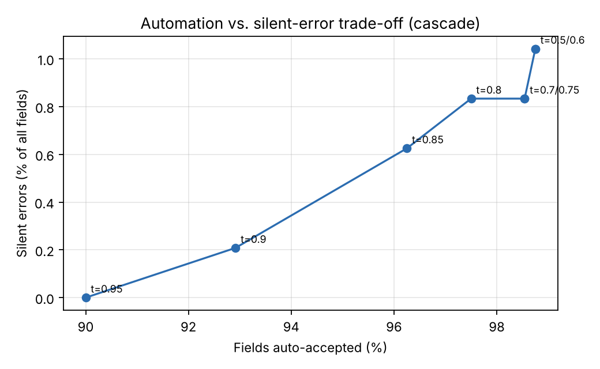

# agentic-extraction-eval

**Multi-agent document extraction with validation, grounding, a model cascade and an evaluation harness.**

Extracting structured data from long, inconsistent technical documents is easy to demo and hard to ship.
The failure that matters is not the field the model leaves blank, it is the field it gets *confidently
wrong*. This repo is a compact, fully reproducible version of the pattern I use in production:

1. a cheap model extracts every field,
2. deterministic rules and a **grounding check** decide what can be trusted,
3. only the doubtful fields go to a stronger model,
4. anything still unresolved goes to a human, and
5. every change is judged by an evaluation suite with a **regression gate in CI**.

The domain here is chemical Safety Data Sheets (SDS): four different layouts, mixed °C/°F units, optional
fields and narrative prose. Everything runs offline in seconds. A real-model adapter (Anthropic) is
included so the same evaluation can be run against live LLMs.

```
extract ─▶ normalize+validate ─▶ route ──(nothing flagged)──────────────────▶ done
 (small model)  (units, schema,     │
                 CAS checksum,      └─(flagged fields)─▶ verify ─▶ reconcile ─▶ done
                 grounding)                            (large model,  (accept, or escalate
                                                        flagged       the field to a human)
                                                        fields only)
```

## Results

60 documents × 8 fields, simulated models (see *How the simulation works*). From `python -m agex compare`:

| Strategy | Auto-accepted accuracy | Silent errors | Fields automated | Docs with no human touch | Model $/doc | Total $/doc incl. review |
|---|---|---|---|---|---|---|
| Small model only | 90.0% | 10.00% | 100% | 100% | 0.00020 | 0.000 |
| Large model only | 98.8% | 1.25% | 100% | 100% | 0.00240 | 0.002 |
| Small + validation gate → human | 99.1% | 0.83% | 90.0% | 40% | 0.00020 | 0.320 |
| Cascade **without** grounding | 97.3% | 2.71% | 98.5% | 88% | 0.00066 | 0.047 |
| **Cascade: small → large → human** | **99.2%** | **0.83%** | **98.5%** | **88%** | **0.00074** | **0.047** |

What the numbers say:

* **The cascade beats the large model on silent errors (0.83% vs 1.25%) at about 30% of its model cost**,
  because the large model is only called on the fields that need it.
* **Grounding is the single most valuable check.** Without it, the cascade lets 3× more errors through.
  Requiring every value to appear verbatim in the source catches the confident errors that schema rules
  can't: a truncated supplier name ("Granite Fin") or a °F value reported as °C.
* **Confidence alone is not enough.** The primary model's 0.8–1.0 confidence bin is still only 94% accurate,
  so confidence is one routing signal among several, never the only gate.
* Sending every doubtful field straight to a human is accurate but expensive: 60% of documents need review.

### Choosing the threshold

`python -m agex sweep --plot` trades automation against silent errors:



| Threshold | Auto-accepted accuracy | Silent errors | Automation | Total $/doc |
|---|---|---|---|---|
| 0.75 (default) | 99.2% | 0.83% | 98.5% | 0.047 |
| 0.85 | 99.4% | 0.62% | 96.2% | 0.122 |
| 0.90 | 99.8% | 0.21% | 92.9% | 0.229 |
| 0.95 | 100.0% | 0.00% | 90.0% | 0.322 |

The right point is a business decision (the cost of a wrong field vs. a minute of review), and this table is
how you make it with evidence instead of intuition.

## Quick start

```bash
git clone https://github.com/bjadidi/agentic-extraction-eval && cd agentic-extraction-eval
pip install -e ".[dev,plot]"

python -m agex compare          # strategy comparison -> reports/results.md
python -m agex sweep --plot     # threshold trade-off -> reports/threshold_tradeoff.png
python -m agex run sds_002      # trace one document through the graph
python -m agex regress          # exit 1 if quality regresses vs reports/baseline.json
pytest -q
```

Example trace:

```
path: extract -> normalize_validate -> route -> verify -> reconcile
flagged: ['manufacturer', 'signal_word']
escalated to human: []
  manufacturer   Granite Fine Chemicals   conf=0.94 source=verifier   <- small model truncated it; grounding caught it
```

### With a real model

```bash
pip install -e ".[llm]"
export ANTHROPIC_API_KEY=...
python -m agex --small claude-haiku-4-5 --large claude-sonnet-4-5 compare
```

## Repository layout

```
src/agex/
  schema.py      target fields, validation rules (CAS check digit, pH range, flash < boiling point)
  parsing.py     layout-agnostic reading + unit normalization (°F -> °C, "not applicable" -> None)
  models.py      SimulatedModel (deterministic, offline) and AnthropicModel (real LLM)
  pipeline.py    the extraction graph: extract -> validate -> route -> verify -> reconcile
  evaluate.py    metrics, calibration table, regression gates
  cli.py         compare / sweep / regress / run
scripts/make_synthetic_sds.py   generates the corpus and gold labels
tests/                          unit tests + behavioural tests of the pipeline
.github/workflows/ci.yml        runs tests and the regression gate on every push
```

## How the simulation works

`SimulatedModel` reads each document with the reference parser and then injects the error types real models
make: missing fields, **unit slips** (°F read as °C), **digit swaps** in CAS numbers and **truncated names**.
Error rates depend on the model tier and are 1.5–2.5× higher on the narrative layout. About half of the
injected errors come back with *high* confidence, as real models often do. Everything is seeded and
deterministic, so results and the regression baseline are stable.

The point of the simulation is to make the *system* testable: routing, grounding, cost and the evaluation
harness. The numbers above describe this synthetic setup, not any specific production system. Swap in a
real model to measure your own documents.

## Design notes

* **Separate reading from normalizing.** Models copy values as written ("203 °F"); code converts units.
  That makes unit slips detectable instead of invisible.
* **Re-extract only flagged fields.** The verifier sees the whole document but answers only for doubtful
  fields, which keeps the cascade cheap.
* **Treat evaluation as a product.** Gold labels, per-field and per-layout accuracy, a calibration table,
  cost and latency, and a CI gate that blocks a merge that makes things worse.
* **Human review is part of the design.** The metric that matters is *silent errors*: wrong values that no
  one looked at.

## License

MIT
